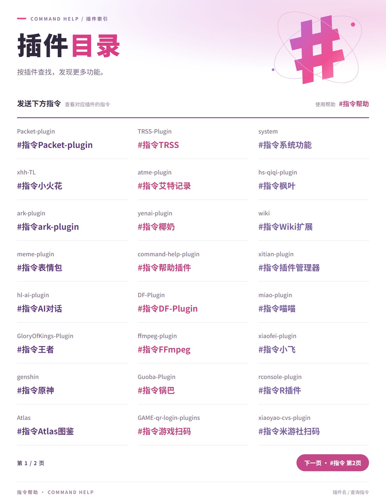

# 指令帮助插件

适配 JiuLi 与云崽生态的插件指令目录、功能卡片、多词搜索、完整消息测试和常用收藏。通过宿主已加载规则生成目录，不执行被测指令。没有需要安装的 npm 依赖。

## 指令速查

| 功能 | 指令与别名 |
| --- | --- |
| 插件目录 | `#指令`、`#指令列表`、`#指令总览`、`#指令 插件` |
| 使用帮助 | `#指令帮助`、`#指令help` |
| 插件功能卡片 | `#指令<插件名>`、`#指令 <插件名>`、`#指令+<插件名>`；只查插件用 `#指令 插件 <插件名>` |
| 关键词搜索 | `#指令<关键词>`、`#指令 <关键词>`、`#指令+<关键词>`；只搜关键词用 `#指令 搜索 <关键词>` |
| 插件内搜索 | `#指令 <插件名> <关键词>`、`#指令 插件 <插件名> <关键词>` |
| 完整文字 | `#指令文字<插件名>`、`#指令文字 <插件名>`、`#指令文字+<插件名>`，同样支持列表、总览、帮助/help、插件/搜索模式、插件内查询和翻页 |
| 完整消息测试 | `#测试命令<完整消息>`、`#测试命令 <完整消息>` |
| 冲突诊断 | `#指令冲突<完整消息>`、`#指令冲突 <完整消息>` |
| 查看自己的收藏 | `#指令收藏`、`#常用指令` |
| 添加收藏 | `#指令收藏 <指令名称>`、`#常用指令 <指令名称>` |
| 取消收藏 | `#取消收藏 <序号>` |
| 主人查看状态 | `#指令状态` |
| 主人刷新目录 | `#指令刷新` |
| 主人更新插件 | `#指令更新` |

目录、卡片、搜索、文字和收藏：原查询后加 ` 第N页`。完整消息测试与冲突诊断使用独立控制参数，保留被测消息本身的页码：

```text
#指令小火花 第2页
#指令文字 小火花 第2页
#常用指令 第2页
#测试命令 --页=2 -- #指令 第2页
#指令冲突 --页=2 -- #绑定
```

被测消息本身以 `--` 开头时，在前面加一个 `-- ` 分隔符，如 `#测试命令 -- --页=2 -- 原消息`。测试和冲突诊断只返回规则候选，不执行命令，也不保证最终由哪个插件响应。

## 安装

在机器人框架的根目录执行，下面三个源任选一个。

**GitCode（国内）**

```sh
git clone https://gitcode.com/ccxhan/command-help-plugin.git ./plugins/command-help-plugin
```

**Gitee（国内）**

```sh
git clone https://gitee.com/longhengmu/command-help-plugin.git ./plugins/command-help-plugin
```

**GitHub**

```sh
git clone https://github.com/cchanlan/command-help-plugin.git ./plugins/command-help-plugin
```

**无需安装依赖**

克隆后即可使用，不需要执行 `pnpm i` 或 `npm install`。

**更新插件**

主人发送 `#指令更新` 更新插件。更新只拉取插件代码，不调用包管理器。

启动机器人后发送 `#指令帮助`。JiuLi 可自动加载新增插件；未自动加载时按宿主框架的方式重启机器人。

最低 Node.js 18.17.0。无需编译、无需填写配置；出图使用宿主渲染器，图片不可用自动回退文字。

## 快速试用

```text
#指令
#指令小火花
#指令绑定
#指令 搜索 签到 自动
#指令 小火花 体力
#指令文字 小火花
#指令收藏 #指令帮助
#常用指令
#取消收藏 1
#测试命令#绑定
#指令冲突 #绑定
#指令状态
#指令刷新
#指令更新
```

把“小火花”换成自己安装的插件中文名或目录名即可。插件名和关键词重名时使用 `#指令 搜索 <关键词>`。

## 效果预览

### 使用帮助


<details>
<summary>查看插件目录示例</summary>



</details>

<details>
<summary>查看插件指令卡片示例</summary>


</details>

目录按各自机器人实际加载的插件生成，每页最多 24 个；插件功能卡片每页最多 6 条。图片失败时按同一页回退文字。完整别名可用 `#指令文字 <插件名>` 查看。图中的插件无需全部安装。

查询最多 200 个 UTF-16 代码单元；查询控制用的页码不计入。`+` 在 `#指令`、`#指令文字` 后可作分隔符，在测试与冲突诊断中则属于被测消息。帮助入口中的 `help` 不区分大小写。

## 匹配、权限与说明

1. **事实来源**：读取 `loader.priority[].plugin.rule`，不重新实例化其他插件。卸载或加载失败的插件不会伪装成可用。
2. **当前会话**：普通用户只看当前事件、权限和群启用状态允许的规则；主人可看全部，并标记「仅主人」「当前会话不适用」「当前会话已禁用」等限制。不调用会发送权限提示的 filtPermission，不修改原始消息。对源码方法首句明确的 `if (!e.isMaster) return false` / `if (!this.e.isMaster) return false` 也会静态补充主人限制；任意自定义业务权限仍不能通用推断。
3. **精确与相关分开**：精确匹配检查原始正则及 flags，保留被测消息；关键词相关检查完整说明与简明名称，不等于只发该词就能执行。宽泛入口在精确测试中单列，普通搜索不混入无关监听。
4. **简明名不是参数示例**：列表省略参数及正则语法，可选开关采用代表写法；需要 UID、数字等参数的实际用法看原插件帮助。大小写敏感的字符类保留大小写，不因展示改写正则语义。
5. **说明来源可辨**：逐条声明/静态方法注释标为「说明」；只有模块说明时标为「模块说明」；仅有功能名时标为「功能名称」。不凭名称编造业务用途，简短说明通常最多 42 字；插件提供的参数资料保留独立用法和示例。
6. **说明静态补全**：内置 Acorn 仅解析插件内有限层级、文件大小的静态声明，匹配原规则、flags、方法名和类名；冲突的说明不擅选，不执行源码。名称和说明在筛选前建立索引，所以「查询余额」可找到 `#中转查询`。
7. **冲突诊断**：按原加载器次序（优先级相同仍保留原顺序）列候选和适用限制。不会调用 accept、上下文、业务方法、网络接口；不能承诺最终由哪个插件响应。普通用户不会借诊断看到无权限规则。

## 内部分发器适配

目前显式适配 `xiaoyao-cvs-plugin` 的已加载 `dispatch → Apps.rule` 入口。

- 静态解析 apps/index.js 与其导入的 userRule/qrRule，支持字面量、静态模板和对象展开；不 import 目标插件，不 eval，不执行函数。
- 只为真实已加载的父入口补充内部候选；内部正则和父入口必须同时匹配，优先级取父入口，不把内部字段误作宿主优先级。
- 显示「内部规则候选」，不保证业务一定返回成功；分发器形态改变或规则表无法静态确认时回退父入口，给主人提示未展开，详细原因写日志。
- 未适配的 accept、动态生成条件和其他分发器仍不能通用枚举，不能把本目录声称为 bot 所有内部业务分支。

## 依赖隔离

解析器 Acorn 8.18.0 随插件固定提供，保留原始 MIT 许可，见 [第三方组件](vendor/acorn/README.md)。插件没有需安装的 npm 依赖；自动更新仅执行 Git，不改宿主依赖、锁文件或其他插件。旧版的安装命令无需再执行。

## 性能与异常隔离

- **检索索引**：同一加载器共享建索引 Promise。签名含实例/类身份、规则顺序、正则、事件、权限、优先级和说明；新增、删除、重载和同实例动态规则变更在下次查询失效。只改源码说明或帮助资料时最多 30 秒刷新，也可用 `#指令刷新` 立即检查。逐文件比较修改时间、创建/状态变化时间、大小和文件标识，只重新解析新增或变更的源码；删除文件的结果会移除。
- **正则隔离**：worker 内编译与测试，保留 flags、不污染 lastIndex；单次 2.5 秒、最多 2 次并发。错误或超时明确标为结果未完成，未查项不当作未命中。
- **出图队列**：同一请求合并，最多 4 个不同请求等待，10 秒总超时；超时返回文字，底层截图未结束时熔断新图，防止旧后端并发覆盖固定 HTML。底层结束后恢复，不强制重启宿主浏览器。
- **图片缓存**：相同可见目录/帮助数据缓存 30 秒，最多 6 张、每张最多 2 MiB；不同权限产生不同目录数据，不混用主人与普通用户目录。失败不缓存。
- **消息发送**：统一检查 error、err、status、success、retcode；图片或转发显式失败时回退当前页文字。文字页同时受 49 条内容和约 3600 字预算限制，转发另加 1 条标题；回退按最多 1600 字分段，避免逐条刷屏。

## 搜索与收藏

空格隔开的多个词需要全部相关，如 `#指令 搜索 签到 自动`。支持“签到/打卡”“帮助/help”“绑定/bind”同义词；精确名称、帮助资料中的检索别名、名称部分匹配和说明匹配依次排序。无结果时可能给出少量相近名称，不会自动执行建议，也不会扩大查询者可见权限。

收藏存储在宿主的 `data/command-help-plugin/favorites.json`，按机器人 ID 和用户 ID 隔离，重启后保留。每用户每机器人最多 50 条，只保存目录中的静态指令名称及来源插件，不保存查询参数、账号或令牌。列表每次按当前会话重新检查权限、禁用状态和插件是否存在；暂不可用的条目隐藏名称，仍保留序号供删除。写入串行且原子替换；文件损坏时停止覆盖并给出提示。建议随宿主 data 一起备份。

## 为插件补充用法与示例

可在需要补充说明的插件根目录创建 `command-help.json`。这是可选的帮助内容资料，不是运行配置；不改其他插件代码也能正常生成卡片。只有可唯一匹配到的已注册规则才会补充内容，不新增规则、不更改权限，不猜参数。

```json
{
  "version": 1,
  "commands": [
    {
      "match": { "fnc": "lookup" },
      "title": "查找指令",
      "description": "按插件或关键词查找可用指令。",
      "category": "检索",
      "usage": "#指令 <关键词>",
      "examples": ["#指令 搜索 签到 自动"],
      "aliases": ["查命令"]
    }
  ]
}
```

`match` 可组合 `fnc`（方法名）、`source`（正则 source）、`flags`、`key`（注册来源键）、`command`（目录中的简明名称）；至少提供一个非 flags 条件，所有条件同时成立且只命中一条规则时应用。`aliases` 仅参与帮助检索，不增加可执行命令别名。文件最大 256 KiB，最多 300 项，每项最多展示 3 个示例。有资料的卡片按 commands 数组顺序分组展示，无资料的条目沿用注册顺序。歧义或格式错误写入日志，并计入主人状态；删掉文件后恢复原说明。当前插件自己的资料可直接参考仓库中的同名文件。

## 主人维护

`#指令状态` 区分插件数、注册规则数、内部候选数与按“插件 + 名称”去重的帮助名称数，并显示专属说明缺失、未完整提取的名称、内部适配告警、资料告警、索引时间、解析复用次数和出图回退状态。这些是当前进程的目录及缓存信息，不等于所有插件内部业务分支数量。

`#指令刷新` 立即重建目录、重新检查源码和帮助资料；未变的文件仍复用解析结果。出图按内容缓存，新内容不会复用旧数据的图片。

`#指令更新` 只在独立插件仓库、官方 origin、main 分支且工作树干净时执行 Git 快进更新。失败会直接提示本地修改、分支/来源不符、网络、认证或分叉差异等原因；详细错误留在运行日志。不会自动丢弃修改、合并分叉或安装依赖。

## 中文查询名

目录卡片上方始终保留原始英文目录名，下方保留可靠中文查询，如 `xhh-TL` / `#指令小火花`。旧目录名仍可用，未知插件不乱起名字。中文品牌精确匹配优先，不让 wiki 冒领喵喵。


## 框架兼容与边界

云崽生态使用 `lib/plugins/plugin.js`、`lib/plugins/loader.js`、`lib/puppeteer/puppeteer.js`，JiuLi 提供兼容入口。要求 loader.priority 公开已加载实例；能力缺失时明确回退，不重新 new 其他插件凑数。没有改宿主内核或其他插件。

JiuLi Linux 真机验证与 Miao/TRSS 注册表结构契约测试分开报告；不能以一侧运行结果代替所有平台实测。Windows、其他框架的真实运行进程仍待后续验证。


## 反馈与源码

- [GitCode](https://gitcode.com/ccxhan/command-help-plugin)
- [Gitee](https://gitee.com/longhengmu/command-help-plugin)
- [GitHub](https://github.com/cchanlan/command-help-plugin)
- [提交问题](https://github.com/cchanlan/command-help-plugin/issues)

反馈时请附上框架名称、Node.js 版本、实际发送的查询指令和相关错误日志；不要提交 Cookie、令牌、机器人账号或群成员隐私。


## 许可证

[MIT](LICENSE)
