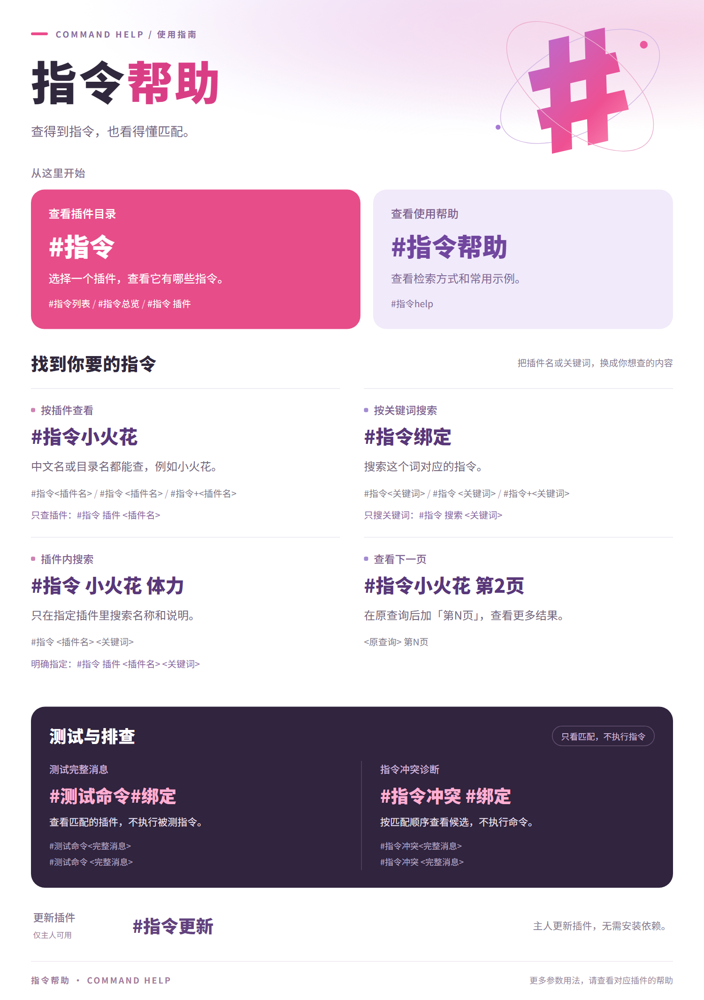

# 指令帮助插件

适配 JiuLi 与云崽生态的规则目录、插件内检索、完整消息测试和只读冲突诊断。帮助图使用框架渲染器；每份合并转发最多 50 条消息（1 条标题 + 49 条内容）。不执行被测指令。

## 能玩什么

- `#指令`、`#指令列表`、`#指令总览`、`#指令 插件`：插件目录图，上方原始目录名、下方中文查询；隐藏 example / demo 展示项。
- `#指令帮助`、`#指令help`：使用帮助图，图片不可用自动发文字。
- `#指令小火花`、`#指令+小火花`：查看插件指令及真实优先级。
- `#指令绑定`、`#指令 搜索 查询余额`：按名称、原规则和原有说明搜索。
- `#指令 小火花 体力`：只搜指定插件。
- `#测试命令#绑定`：匹配完整消息，保留实际被测写法，不执行业务。
- `#指令冲突 #绑定`：按加载器顺序列出匹配候选、优先级和场景限制。
- `#指令更新`：仅主人可用，更新插件，无需安装依赖。
- 已加载 xiaoyao 的 Apps.rule 分发器可静态展开内部规则；未适配的其他分发器不冒充已抓全。

## 安装

在机器人框架的根目录执行，下面三个源任选一个。

**GitCode（国内）**

```sh
git clone https://gitcode.com/ccxhan/command-help-plugin.git ./plugins/command-help-plugin
```

**Gitee（国内）**

```sh
git clone https://gitee.com/longhengmu/command-help-plugin.git ./plugins/command-help-plugin
```

**GitHub**

```sh
git clone https://github.com/cchanlan/command-help-plugin.git ./plugins/command-help-plugin
```

**无需安装依赖**

克隆后即可使用，不需要执行 `pnpm i` 或 `npm install`。

**更新插件**

主人发送 `#指令更新` 更新插件。更新只拉取插件代码，不调用包管理器。

启动机器人后发送 `#指令帮助`。JiuLi 可自动加载新增插件；未自动加载时按宿主框架的方式重启机器人。

最低 Node.js 18.17.0。无需编译、无需填写配置；出图使用宿主渲染器，图片不可用自动回退文字。

## 快速试用

```text
#指令
#指令小火花
#指令绑定
#指令 搜索 查询余额
#指令 小火花 体力
#测试命令#绑定
#指令冲突 #绑定
#指令更新
```

把“小火花”换成自己安装的插件中文名或目录名即可。插件名和关键词重名时使用 `#指令 搜索 <关键词>`。

## 效果预览

### 使用帮助



<details>
<summary>查看插件目录示例</summary>


</details>

目录按各自机器人实际加载的插件生成，每页最多 24 个；发送 `#指令 第2页` 翻页。图片失败时按同一页回退文字。图中的插件无需全部安装。

## 指令表

| 指令及别名 | 用途 |
| --- | --- |
| `#指令`、`#指令列表`、`#指令总览`、`#指令 插件` | 插件目录图 |
| `#指令帮助`、`#指令help` | 使用帮助图，help 不区分大小写 |
| `#指令<插件名>`、`#指令 <插件名>`、`#指令+<插件名>` | 按中文名/目录名查看插件 |
| `#指令<关键词>`、`#指令 <关键词>`、`#指令+<关键词>` | 名称及说明检索，优先识别插件名 |
| `#指令 搜索 <关键词>` | 强制关键词搜索，避免与插件名重合 |
| `#指令 插件 <插件名>` | 强制插件查询，允许完整模块名 |
| `#指令 <插件名> <关键词>`、`#指令 插件 <插件名> <关键词>` | 插件内搜索，例如 `#指令 小火花 体力` |
| `#测试命令<完整消息>`、`#测试命令 <完整消息>` | 完整消息匹配，不执行 |
| `#指令冲突<完整消息>`、`#指令冲突 <完整消息>` | 只读候选冲突诊断 |
| `#指令更新` | 仅主人；更新插件，无需安装依赖 |
| `<以上查询> 第N页` | 翻页，例如 `#指令 小火花 体力 第2页` |

查询最多 200 个 UTF-16 代码单元，页码后缀不计入；`+` 只在 `#指令` 后作为可选分隔符。`#测试命令`、`#指令冲突` 后的 `+` 是被测消息内容。

## 匹配、权限与说明

1. **事实来源**：读取 `loader.priority[].plugin.rule`，不重新实例化其他插件。卸载或加载失败的插件不会伪装成可用。
2. **当前会话**：普通用户只看当前事件、权限和群启用状态允许的规则；主人可看全部，并标记「仅主人」「当前会话不适用」「当前会话已禁用」等限制。不调用会发送权限提示的 filtPermission，不修改原始消息。对源码方法首句明确的 `if (!e.isMaster) return false` / `if (!this.e.isMaster) return false` 也会静态补充主人限制；任意自定义业务权限仍不能通用推断。
3. **精确与相关分开**：精确匹配检查原始正则及 flags，保留被测消息；关键词相关检查完整说明与简明名称，不等于只发该词就能执行。宽泛入口在精确测试中单列，普通搜索不混入无关监听。
4. **简明名不是参数示例**：列表省略参数及正则语法，可选开关采用代表写法；需要 UID、数字等参数的实际用法看原插件帮助。大小写敏感的字符类保留大小写，不因展示改写正则语义。
5. **说明来源可辨**：逐条声明/静态方法注释标为「说明」；只有模块说明时标为「模块说明」；仅有功能名时标为「功能名称」。不凭名称编造业务用途，每条展示最多 42 字。
6. **说明静态补全**：内置 Acorn 仅解析插件内有限层级、文件大小的静态声明，匹配原规则、flags、方法名和类名；冲突的说明不擅选，不执行源码。名称和说明在筛选前建立索引，所以「查询余额」可找到 `#中转查询`。
7. **冲突诊断**：按原加载器次序（优先级相同仍保留原顺序）列候选和适用限制。不会调用 accept、上下文、业务方法、网络接口；不能承诺最终由哪个插件响应。普通用户不会借诊断看到无权限规则。

## 内部分发器适配

目前显式适配 `xiaoyao-cvs-plugin` 的已加载 `dispatch → Apps.rule` 入口。

- 静态解析 apps/index.js 与其导入的 userRule/qrRule，支持字面量、静态模板和对象展开；不 import 目标插件，不 eval，不执行函数。
- 只为真实已加载的父入口补充内部候选；内部正则和父入口必须同时匹配，优先级取父入口，不把内部字段误作宿主优先级。
- 显示「内部规则候选」，不保证业务一定返回成功；分发器形态改变或规则表无法静态确认时回退父入口，给主人提示未展开，详细原因写日志。
- 未适配的 accept、动态生成条件和其他分发器仍不能通用枚举，不能把本目录声称为 bot 所有内部业务分支。

## 依赖隔离

解析器 Acorn 8.18.0 随插件固定提供，保留原始 MIT 许可，见 [第三方组件](vendor/acorn/README.md)。插件没有需安装的 npm 依赖；自动更新仅执行 Git，不改宿主依赖、锁文件或其他插件。旧版的安装命令无需再执行。

## 性能与异常隔离

- **检索索引**：同一加载器共享建索引 Promise。签名含实例/类身份、规则顺序、正则、事件、权限、优先级和说明；新增、删除、重载和同实例动态规则变更在下次查询失效。只改源码说明时最多 30 秒刷新。
- **正则隔离**：worker 内编译与测试，保留 flags、不污染 lastIndex；单次 2.5 秒、最多 2 次并发。错误或超时明确标为结果未完成，未查项不当作未命中。
- **出图队列**：同一请求合并，最多 4 个不同请求等待，10 秒总超时；超时返回文字，底层截图未结束时熔断新图，防止旧后端并发覆盖固定 HTML。底层结束后恢复，不强制重启宿主浏览器。
- **图片缓存**：相同可见目录/帮助数据缓存 30 秒，最多 6 张、每张最多 2 MiB；不同权限产生不同目录数据，不混用主人与普通用户目录。失败不缓存。
- **消息发送**：统一检查 error、err、status、success、retcode；图片或转发显式失败时回退文字，无转发能力时发当前页文字。

## 中文查询名

目录卡片上方始终保留原始英文目录名，下方保留可靠中文查询，如 `xhh-TL` / `#指令小火花`。旧目录名仍可用，未知插件不乱起名字。中文品牌精确匹配优先，不让 wiki 冒领喵喵。


## 框架兼容与边界

云崽生态使用 `lib/plugins/plugin.js`、`lib/plugins/loader.js`、`lib/puppeteer/puppeteer.js`，JiuLi 提供兼容入口。要求 loader.priority 公开已加载实例；能力缺失时明确回退，不重新 new 其他插件凑数。没有改宿主内核或其他插件。

JiuLi Linux 真机验证与 Miao/TRSS 注册表结构契约测试分开报告；不能以一侧运行结果代替所有平台实测。Windows、其他框架的真实运行进程仍待后续验证。


## 反馈与源码

- [GitCode](https://gitcode.com/ccxhan/command-help-plugin)
- [Gitee](https://gitee.com/longhengmu/command-help-plugin)
- [GitHub](https://github.com/cchanlan/command-help-plugin)
- [提交问题](https://github.com/cchanlan/command-help-plugin/issues)

反馈时请附上框架名称、Node.js 版本、实际发送的查询指令和相关错误日志；不要提交 Cookie、令牌、机器人账号或群成员隐私。


## 许可证

[MIT](LICENSE)
